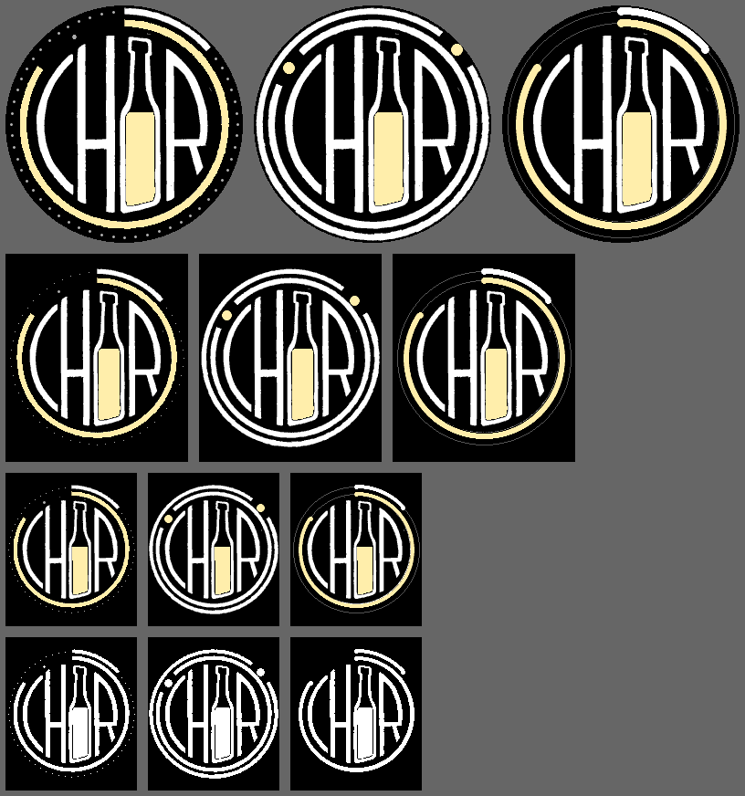

# WKC – Würzburger Kneipenchor Watchface

Ein Pebble-Watchface aus dem Logo des Würzburger Kneipenchors. Der runde Teil des Logos
(„CHOR“ mit Flasche) ist das Zifferblatt, die beiden Ringe sind die Zeiger:
**außen = Minuten, innen = Stunden** (beide starten bei 12 Uhr, im Uhrzeigersinn).

| Pegel | Lücke | Prost |
|:---:|:---:|:---:|
|  |  |  |
| Die Original-Ringe füllen sich, der Rest ist als Punktreihe angedeutet | Ringe komplett wie im Logo, ein Kronkorken in der Lücke zeigt die Zeit | Glatte Bögen, die Stunden in Biergelb |

Läuft auf allen Pebbles: Pebble Classic/Steel, Time, Time Round, Pebble 2, 2 Duo, Time 2 und Round 2.
Die Screenshots stammen aus dem Emulator und zeigen alle 10:08 Uhr.



## Einstellungen

In der Pebble-App beim Watchface auf **Einstellungen** tippen:

- **Zifferblatt:** Pegel, Lücke oder Prost
- **Akkustand als Bier in der Flasche:** ein/aus (für alle drei Designs)

Die Flasche wird wie eine echte Flasche gefüllt. Bei 80 % steht das Bier am Ende des
Flaschenhalses, darunter sinkt es gleichmäßig bis zum Boden. Auch bei 100 % bleibt oben
etwas Luft.


## Installieren (ohne Programmierkenntnisse)

1. Unter [Releases](../../releases/latest) die Datei `WKC-Kneipenchor.pbw` aufs Handy laden.
2. Die Datei mit der [Pebble-App](https://repebble.com/app) öffnen. Die App installiert das
   Watchface auf der gekoppelten Uhr.

## Selbst bauen

Das SDK läuft unter Linux, macOS oder Windows mit WSL.

```sh
uv tool install pebble-tool --python 3.13
pebble sdk install latest
pebble build                       # -> build/wkc-watchface.pbw
pebble install --emulator gabbro   # im Emulator testen (Round 2)
pebble emu-app-config --emulator gabbro   # Einstellungsseite im Browser öffnen
```

Auf die eigene Uhr: in der Pebble-App unter *Devices* → ⋮ die *Dev Connection* einschalten, dann

```sh
pebble login
pebble install --cloudpebble
```

### Aufbau

| Pfad | Inhalt |
|---|---|
| `src/c/main.c` | Watchface (Zeichnen, Einstellungen empfangen) |
| `src/c/bottle.h` | Füllstände der Flasche, generiert |
| `src/pkjs/config.js` | Einstellungsseite ([Clay](https://github.com/pebble-dev/clay)) |
| `tools/make_assets.py` | erzeugt die Grafiken aus dem Logo |
| `logo/` | Original-Logo als SVG |

### Logo-Grafiken neu erzeugen

`tools/make_assets.py` rendert das SVG (braucht Inkscape, numpy, scipy und Pillow) und trennt
„CHOR“ und die Flasche von den Ringen. Es richtet die handgezeichneten Ringe exakt kreisrund aus,
die Textur bleibt dabei erhalten. Pro Plattform schreibt es `resources/images/logo~<platform>.png`,
`beer~<platform>.png` und `ring~<platform>.png` sowie die Füllstände nach `src/c/bottle.h`.

```sh
python3 tools/make_assets.py logo/Kneipenchor_logo_fertig.svg
```

Für Screenshots mit fester Uhrzeit (10:08) oben in `src/c/main.c` `#define WKC_DEMO` setzen.
Einstellungen lassen sich im Emulator ohne Browser setzen:

```sh
pebble send-app-message --emulator gabbro --string 10000=1 --int 10001=1   # Lücke, Akku an
```

## Das Pebble-Universum

- [repebble.com](https://repebble.com): Pebble von Core Devices (Pebble 2 Duo, Time 2, Round 2)
- [Pebble-App](https://repebble.com/app) für iOS und Android
- [Pebble Appstore](https://apps.repebble.com): Watchfaces und Apps
- [Entwicklerportal](https://developer.repebble.com): Doku und Guides
  - [SDK installieren](https://developer.repebble.com/sdk)
  - [Watchface-Tutorial](https://developer.repebble.com/tutorials/watchface-tutorial/part1/)
  - [Einstellungsseiten](https://developer.repebble.com/guides/user-interfaces/app-configuration/)
  - [Hardware und Plattformen](https://developer.repebble.com/guides/tools-and-resources/hardware-information/)
  - [Im Appstore veröffentlichen](https://developer.repebble.com/guides/appstore-publishing/)
- [CloudPebble](https://cloudpebble.repebble.com): Entwicklungsumgebung im Browser
- [PebbleOS](https://github.com/coredevices/PebbleOS): das Open-Source-Betriebssystem der Uhr
- [Rebble](https://rebble.io): die Community, die Pebble nach dem Aus 2016 am Leben gehalten hat ([Discord](https://rebble.io/discord))
- [pebble-dev auf GitHub](https://github.com/pebble-dev): Community-Werkzeuge, unter anderem Clay

## Logo

Das Logo gehört dem Würzburger Kneipenchor und ist nicht Teil einer freien Lizenz.
